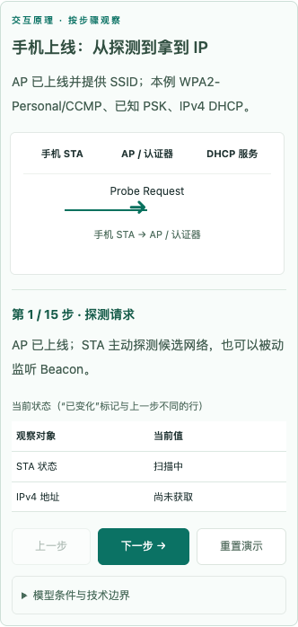
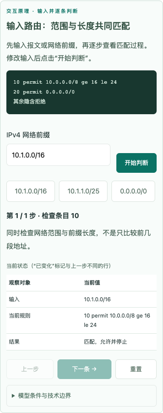
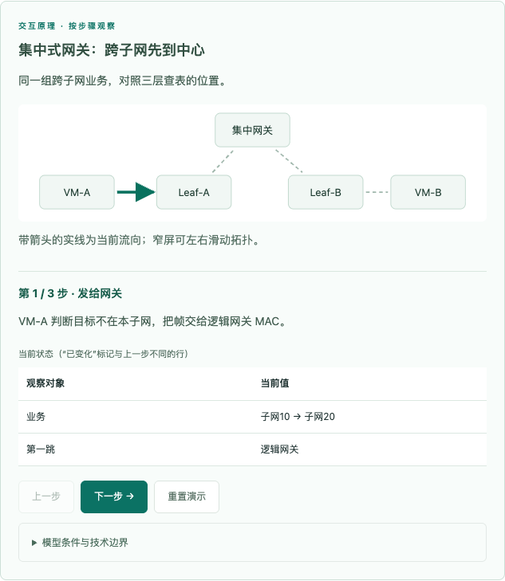
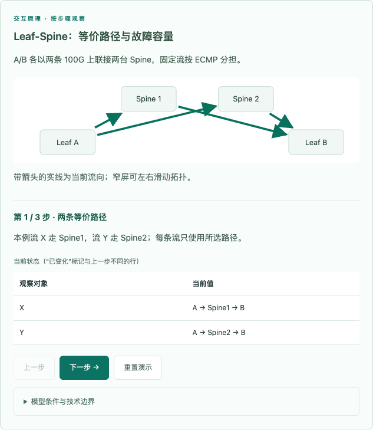

# 可视化扩展与内容归属修复验收

日期：2026-10-25（Asia/Shanghai）。本轮按用户给出的八类不足补充演示，并在自检后提交推送。

## 内容归属

- ICT-045.03 分布式 VXLAN：移入分布式网关与 IRB 正文；.04 跨域 VXLAN：移入跨域边界与互联正文；.05 EVPN：移入路由通告与 RT/RD 正文。
- ICT-079.03 控制平面：移入 AP/WAC 控制通道、防伪造与资源保护；.04 转发平面：移入用户授权、直接/集中转发执行点。
- 按完整知识点移动目标、导语、分节、检查、案例、结论与边界，保留稳定细则 ID；out → freeze → merge → build 均通过，离线手册同步更新。

## 新增内容

37 个数据场景，另有 ACL/前缀列表/路由策略 3 个输入工具。现为 58 数据场景、1 生成场景、4 原实验和3 输入工具，共覆盖 63/322 知识点、47/94 章；DCN 11/11 章有演示。

| 方向 | 新增演示 |
| --- | --- |
| VLAN | VLANIF 跨网段路径、MUX 角色访问矩阵、Sub-VLAN 间代理 ARP |
| 聚合/生成树 | Selected 成员与逐流分担、断链容量、RSTP 角色变化、MSTP 不同实例树 |
| 规则判断 | 输入协议/源地址/端口执行 ACL；输入路由前缀执行列表和策略，显示首匹配、继续、属性应用和拒绝 |
| IPv6/SRv6/VPN/组播 | RA/DAD/ND、Hop Limit、SRH DA/SL、双标签与 PHP、RPF 与复制分支 |
| 可靠性/QoS | VRRP 故障接管与抢占、BFD 与业务模块联动、有限队列调度与尾丢 |
| DCN | Leaf-Spine、集中/分布式网关、跨域、EVPN、虚机、OpenStack、容器、PFC/ECN、编排、多 DC、存储 IO、安全链、分层定界 |
| WLAN | 独立 STA 上线 15 步、直接/隧道转发、热备、信道竞争与重叠、覆盖/容量两本账、控制/数据面保护 |
| 安全 | Trust/DMZ 会话双向路径、反向新连接、双机同步、服务链及绕行故障 |

AP 的 CAPWAP 上线继续属于 ICT-074.01；STA 探测、802.11 认证、关联、WPA2 四次握手、DHCP 属于 ICT-074.02。固定模型条件在各演示边界中明确，不冒充通用设备仿真。

## 自检

- 构建：94/94 章、322/322 知识点，无 LEGACY；冻结与合并通过。
- test-models：4746 断言；test-teaching：1438；test-expanded：531（新增并纳入 CI）。
- 新回归覆盖错位修复、11 章 DCN 挂接、ACL 条件与首匹配、前缀长度边界/默认路由、策略后续节点、非法输入、SRH/标签/队列状态及拓扑箭头引用。
- 全章渲染、三份手写 JS 语法、词库检查与 7 项 Python 回归通过。内容审计 0 错误、70 条术语启发式提示（上一轮 73）；未为消除提示修改标准。
- Chrome headless：94 章 × 1280/390px，共 188 次页面检查，无整页横向溢出、无 pageerror。37 新场景两宽度共 196 次前进操作，逐项检查标题、末步禁用、回退、重置；3 个输入工具的样例、错误输入与重置通过。
- 8 张关键截图已逐张查看：手机上线、前缀判断、集中网关与 Leaf-Spine，各有桌面与窄屏。窄屏拓扑在内部滚动，保留文字大小。
- 浏览器截图检查发现旧 topology 渲染器把 `${marker}` 保留为字面文本，导致箭头缺失；已修复正/反向引用、固定箭头颜色，并增加回归与重跑浏览器验收。

复现：运行 README 的完整检查，另运行 `node scripts/test-expanded.cjs`。浏览器回归在启动本地服务器、具备 Playwright 与 Chrome 的环境执行 `node scripts/check-expanded-browser.cjs`；可用 ICT_TEST_URL 改地址。

本轮未执行赛事设备实机命令、Safari/Windows/真实手机测试；这些不包含在上述通过结论中。性能与容量数字是明确写出的教学假设。

## 新场景挂接清单

| ID | 细则 | 演示 |
| --- | --- | --- |
| vlanif-route | ICT-004.02 | VLANIF：跨网段时谁改了什么？ |
| mux-matrix | ICT-004.03 | MUX VLAN：按角色读访问矩阵 |
| super-vlan-proxy | ICT-004.04 | Sub-VLAN：代理 ARP 怎样接上两端？ |
| lag-member-failure | ICT-005.01 | 聚合：选成员与断链重分配 |
| rstp-failure | ICT-008.01 | RSTP：断链前后的端口角色 |
| mstp-instance-path | ICT-008.02 | MSTP：同一根线上的两棵树 |
| ipv6-nd-slaac | ICT-018.01 | IPv6：路由、地址与邻居分开获得 |
| ipv6-hop-fields | ICT-017.01 | IPv6：逐跳改变什么字段？ |
| srv6-segment-hop | ICT-021.02 | SRH：段列表为何与访问顺序相反？ |
| vpn-two-labels | ICT-029.01 | MPLS VPN：两层标签各负责哪一段？ |
| multicast-rpf-tree | ICT-033.01 | 组播：先查 RPF，再沿树复制 |
| vrrp-master-switch | ICT-037.01 | VRRP：虚拟网关如何换主人？ |
| bfd-client-action | ICT-037.02 | BFD：检测与业务切换分开看 |
| qos-queue-congestion | ICT-038.01 | QoS：拥塞如何变成排队与丢包？ |
| leaf-spine-failure | ICT-054.01 | Leaf-Spine：等价路径与故障容量 |
| vxlan-central-gateway | ICT-045.02 | 集中式网关：跨子网先到中心 |
| vxlan-distributed-gateway | ICT-045.03 | 分布式网关：本地路由后入隧道 |
| dcn-border-path | ICT-045.04 | 跨域：广播域是否也要延伸？ |
| dcn-evpn-learning | ICT-045.05 | EVPN：先通告位置，再送数据 |
| virtual-host-path | ICT-046.02 | 虚机：同宿主与跨宿主路径 |
| openstack-create-path | ICT-047.01 | OpenStack：创建请求不等于数据通路 |
| container-service-path | ICT-050.04 | 容器：Pod、Service、策略三层路径 |
| pfc-ecn-feedback | ICT-048.01 | PFC 与 ECN：暂停与端到端反馈 |
| orchestration-dependencies | ICT-049.04 | 编排：依赖图如何变成开通顺序？ |
| multidc-route-boundary | ICT-051.01 | 多 DC：前缀到边界，身份随租户 |
| storage-io-path | ICT-052.02 | 存储：一次 IO 经历哪些等待？ |
| dcn-security-chain | ICT-053.03 | 服务链：双向都要经过状态设备 |
| dcn-evidence-path | ICT-055.02 | DCN 定界：从 VM 到出口逐段取证 |
| sta-wpa2-online | ICT-074.02 | 手机上线：从探测到拿到 IP |
| wlan-forwarding-architecture | ICT-075.03 | 直接转发与隧道转发：策略放在哪？ |
| wlan-hot-standby | ICT-076.01 | WAC 热备：接管地址还要接管状态 |
| wlan-channel-interference | ICT-082.07 | 信道：竞争、重叠、外部干扰分开看 |
| wlan-coverage-capacity | ICT-086.03 | 覆盖与容量：两本账共同决定点位 |
| wlan-control-defense | ICT-079.03 | 控制面：AP 在线条件逐层验证 |
| wlan-data-defense | ICT-079.04 | 转发面：授权落在数据经过处 |
| security-zone-session | ICT-060.02 | 安全域与会话：去程、回程、拒绝路径 |
| firewall-ha-session | ICT-063.01 | 安全双机：路径与会话一起切换 |

## 关键截图

## 发布

用户已授权推送 main。源码提交与 GitHub Pages 构建/部署分别确认；部署运行结果以 GitHub Actions 为准。
