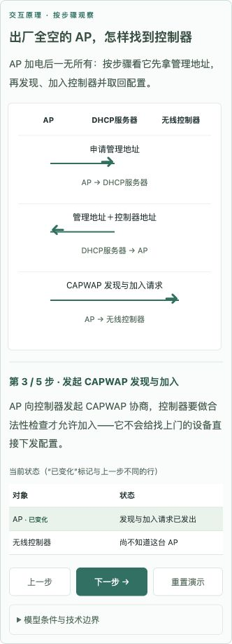
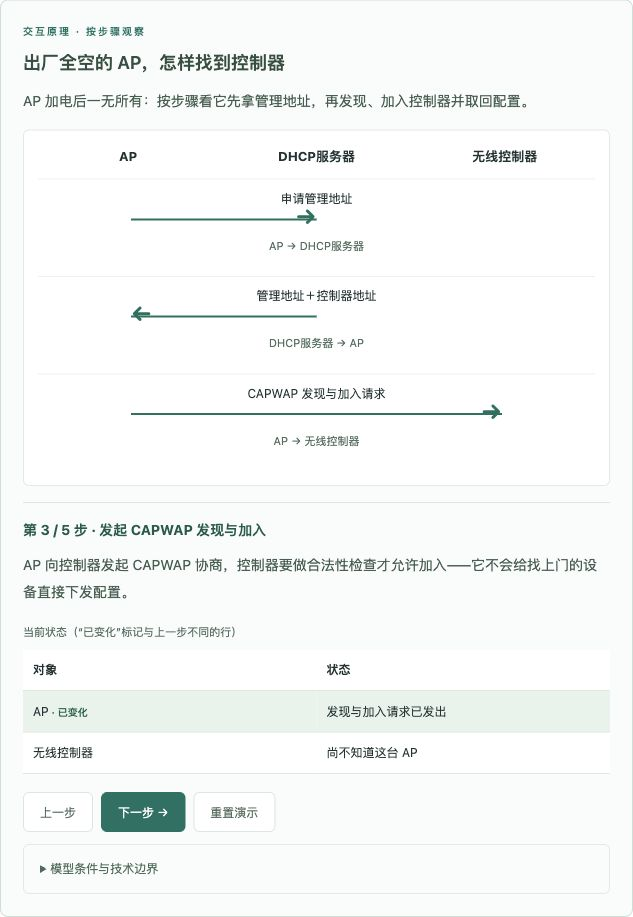
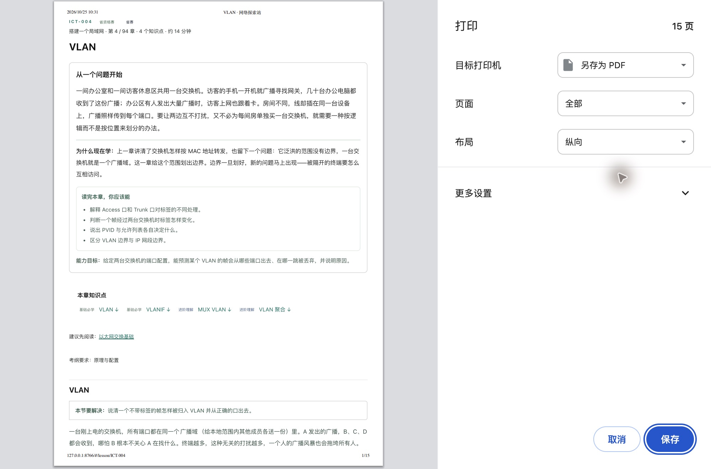

# 阅读体验与项目收口验收

日期：2026-10-25（Asia/Shanghai）。本轮按用户要求修复审查中的问题 1、2、4、5、6；问题 3（赛事版本、真机和逐项来源核对）不在本轮范围。

## 修复结果

| 项目 | 问题与修复 | 验证 |
| --- | --- | --- |
| 正文底色 | `.level-*` 既用于正文容器又用于标签，整段正文错误继承背景/边框；样式收窄为 `.level-badge.level-*` | 94 章 × 5 宽度，正文无背景串用 |
| 窄屏布局 | 移除 `html,body` 的 `overflow-x:hidden`；修正 flex/grid 子项最小宽度、标题工具栏换行、表格与长链接断行 | 470 个章节/视口组合无整页横向溢出 |
| 移动目录 | 增加遮罩、背景 inert、滚动锁定、焦点循环、Escape 关闭和焦点归还；放大到桌面时自动退出抽屉状态 | 键盘开关、Tab/Shift+Tab、遮罩和尺寸切换通过 |
| 可视化 | 三端时序箭头按真实发送/接收方定位，新增端点文字；图示/状态表可键盘滚动，切步保留横向位置，空图示不占空间 | 22 个可选场景 × 2 宽度，266 个步骤及全部重置通过 |
| 字号与术语 | 修正字号按钮被更具体规则覆盖的问题；窄屏字号可在 17px/13px 切换；弹窗适配动态视口并补搜索对话框名称 | 字号、术语、搜索和标记持久化回归通过 |
| 打印 | `beforeprint` 展开正文折叠区并初始化实验，`afterprint` 恢复原状态；保留演示结果，隐藏控件，允许大组件跨页 | Chrome VLAN 15 页预览包含答案/配置/实验；取消后折叠状态恢复 |
| 词库校验 | 按 ID 比较已合并库与新增词条，不再让已合并项与自身碰撞；合并可重复执行 | 181 条误报 → 0 错误；两次合并不改变文件 |
| 校验健壮性 | 修正 `validate_rewrite.py` 异常长度分支的未定义 MIN/MAX | 7 项 Python 回归测试通过；纳入 CI |

## 8 个长单元的整理

只精简分节正文，保留知识点编号、层次、目标、情境导语、分节步骤、案例、理解检查、小结、边界与图示提示。配置与来源数据不变。修改按 out → 校验 → 重新冻结 → frozen 合并 → build 完成，未直接编辑合并产物。

字符数使用 `audit_content.py` 口径（包括案例与边界），不是汉字数或阅读时长：

| 知识点 | 整理前 | 整理后 |
| --- | ---: | ---: |
| ICT-062.01 | 2674 | 1576 |
| ICT-074.01 | 3254 | 1792 |
| ICT-074.02 | 3218 | 1731 |
| ICT-074.03 | 3283 | 1679 |
| ICT-075.03 | 3109 | 1628 |
| ICT-078.01 | 2826 | 1639 |
| ICT-085.01 | 2729 | 1471 |
| ICT-085.03 | 3112 | 1611 |

审计结果从 0 error / 81 warning 变为 **0 error / 73 warning**。8 条长单元警告消除；其余为术语覆盖启发式，保留提示，未降低阈值或通过增加关键词消警。

## 浏览器验收范围

- 内置浏览器：94 章 × 1280/1024/768/500/390px，共 470 组；另检查首页、目录、资料及 19 个代表章节的 5 宽度组合（110 组）。无整页横向溢出，未依赖全页裁切。
- 场景：21 个数据场景 + 1 个生成场景（含 ARP 下拉选择变体）在 390 与 1280px 下累计 266 个步骤；全部可前进并重置。场景文字未超出节点框。15 个新增场景的两种宽度截图均逐张查看，排版与箭头无碰撞。
- Google Chrome：用 Computer Use 打开本地 VLAN 章节，检查 100%/125%/150% 缩放，侧栏与右侧目录按断点切换；打印预览和取消恢复通过。原有其他标签页未修改，缩放已恢复。
- 四个嵌入实验在 390px 下初始化结果正确、无整页溢出；搜索、术语弹窗、移动目录键盘操作、图示横向滚动保留、上下学习标记同步、刷新后标记保留及取消均通过。
- Safari 原生启动检查超时；未取得独立 Safari 验收结果。真实 iOS/Android、Windows 字体和读屏软件未测试，不能将上述结果推广为全设备兼容承诺。

## 自动检查

- build：94/94 章、322/322 知识点，无 LEGACY。
- test-models：4746 项断言通过；test-teaching：1011 项断言通过（增加三端时序端点定位回归）。
- render_check：全部章节与首页/目录/资料页通过。
- audit_content：0 错误 / 73 提示；validate_glossary：135 条、236 别名、0 错误 / 0 提示。
- test_validators：7 项通过，包含真实别名冲突、重复 ID、缺失/改写词条、基线保护与异常长度分支。
- 无新增运行时依赖。截图与浏览器步骤结果供维护复查，见本目录 screenshots/ 和 browser-scenes.json。

## 预览

## 发布与范围边界

本轮本地验收已完成，2026-10-25 用户随后授权提交并推送 GitHub。原有 GitHub Pages 部署流程保留，并增加术语与 Python 回归检查；main 推送后自动执行，最终发布结果以对应 Actions 与线上资源版本为准。赛事设备与版本、322 项精确来源映射继续作为问题 3 的待验事项，不因本轮 UI 和内容整理标记完成。
