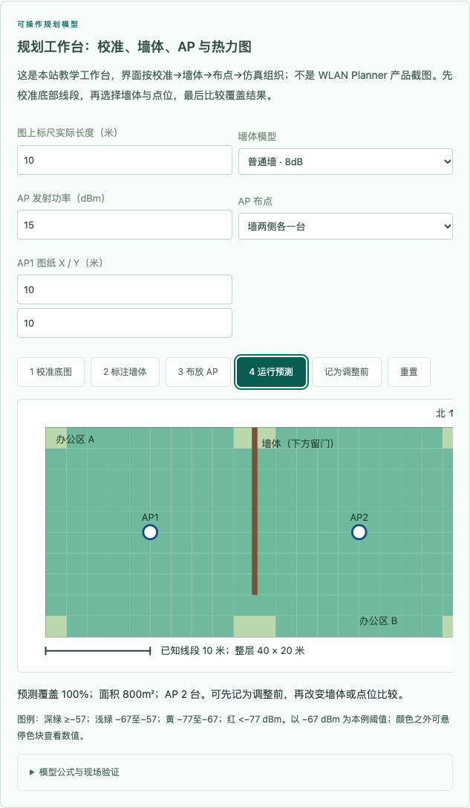
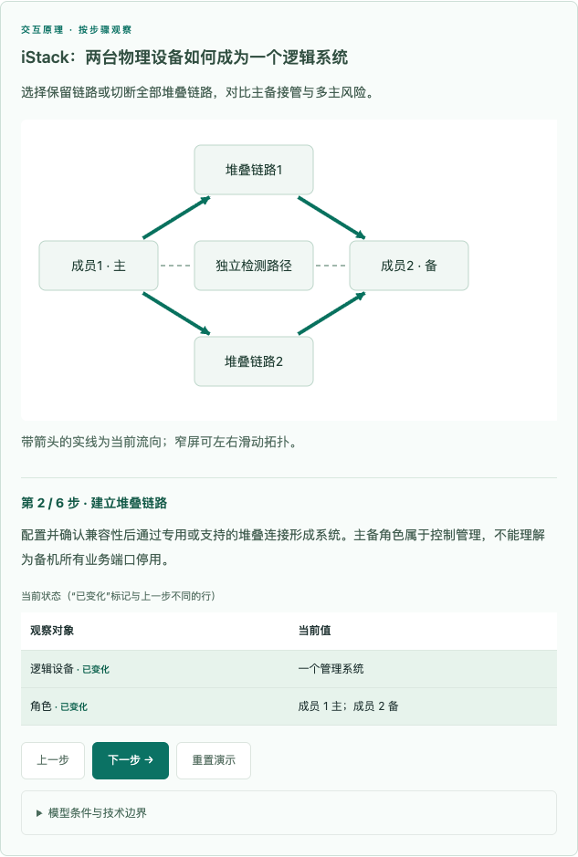
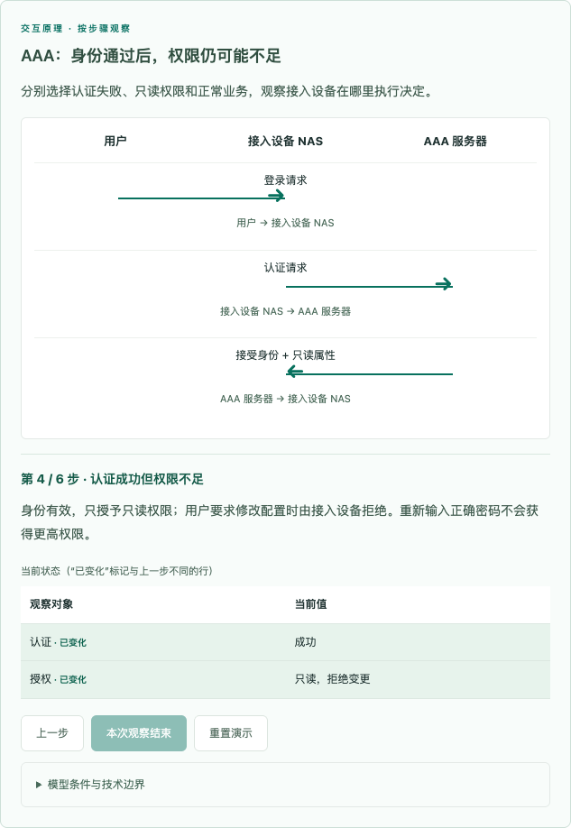
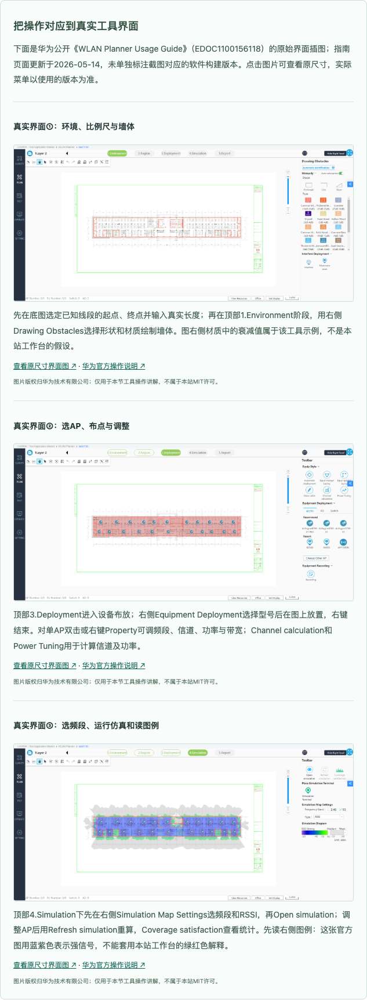

# 按教学问题补图、分支与实验材料

日期：2026-10-25（Asia/Shanghai）。本轮为本地实现与验收，未推送或部署。工作区原有清理、文档变更与文件删除保留，未将这些归为本轮完成项。

## 交付范围

新增48个数据场景、4处可操作规划工作台、11份配套实验和3张附控件说明的WLAN Planner官方界面图；重做BGP数值比较表和无线信道频谱图。现有106个数据场景、1个生成场景、4个原实验、3个规则输入工具与4处规划工作台，图示/交互覆盖113/322知识点、73/94章（实验材料不额外计入图示覆盖）。

| 用户指出的问题 | 本轮落点与可观察变化 |
| --- | --- |
| 堆叠/集群 | ICT-006.01/.02：独立设备→合并→主备角色；分别显示两条堆叠互联和独立检测；可选择单链路故障、全部互联断开、主成员掉电，区分冗余、分裂和控制接管 |
| OSPFv3、IS-IS | ICT-011.01、012.01/.02：Area1/ABR/Area0，L1/L1-L2/L2；区分邻接、数据库传播与业务转发；配两路由器配置实验 |
| AAA | ICT-034.01–.03：三端时序，可选择身份拒绝、只读授权和正常会话；计费Start/Stop按会话关联，失败登录不冒充正常会话计费 |
| 交换安全八项 | ICT-035.01–.08均有独立演示与对应证据；DHCP可选择错误信任端口，IPSG可选择合法/伪造源；明确入口丢弃和租约绑定 |
| 自动化基础/高阶 | ICT-040.01/.02/.03、041.01–.04：清单/差异/回读、SSH主机身份、YANG配置/状态树、NETCONF能力与candidate事务、Telemetry断流、RESTCONF的GET/条件PUT/412/回读漂移；下载的Python fixture展示实际离线输出 |
| VPN、IPv6过渡、SR | 6PE/6VPE、NAT64、GRE/L2TP/IPsec、SR-MPLS补图；真正嵌套内外层，区分标签承载、隧道封装、地址翻译；SR可改段路径 |
| FlexE、IFIT、组播 | 日历时隙分配图；同/错窗口计数对照、时钟偏差对单向时延的影响；IGMP成员加入/离开与复制树 |
| 加解密、威胁、安全运维 | ICT-061.01/.02的会话密钥/私钥/证书信任链；064.01、065.01、069.01/.05的攻击阶段、证据与处置执行点 |
| 定位/规划/优化 | ICT-084.02楼层观测点与遮挡偏移；086.02、087.01、088.03、089.04可调比例尺、墙损、功率、AP布局/坐标，分步生成预测图并保存调整前结果 |
| 综合方案 | CloudCampus、SD-WAN、CloudWAN、园区/数据中心/混合云安全与综合安全新增业务路径和管理下发路径；SD-WAN区分备用合格和两条均超门限 |
| 现有演示改进 | BGP并列数值表；2.4GHz同频/重叠/复用频谱；断链、错误掩码、ACL方向、链路质量等条件分支与预测 |
| 实验材料 | `content/labs.json`保存拓扑、地址、平台约束、操作、预期判读、故障和恢复；网页折叠展示，离线手册同步收录。OSPFv3和IS-IS给出两端配置；其余方案明确依赖的版本与先决配置，不伪称完整设备脚本 |
| 压缩重复正文 | ICT-087.01分节正文1907→554字，.02由1821→498字；保留案例、检查和边界，将步骤依赖交给工作台与实验承担 |

## 额外发现并修复

1. 原BGP演示先选best再排查下一跳，甚至保留不可达best。改为先排除无效候选，再比属性；下一跳恢复后重新计算，最后单独检查主路由表安装与业务。正文提示、结论与冻结副本同步修正，依据RFC4271 §9.1.2。
2. 普通时序图按编号累积步骤，成功分支会混入另一分支的拒绝消息。改为只渲染实际历史路径，并增加认证成功/失败互斥回归。
3. 拓扑固定160高画布与固定节点文字，容易裁切多层拓扑。改为按坐标层级生成画布、节点文字分行与间距；缩小箭头头部，保留图内滚动。
4. 两条堆叠链路分别画出，不重叠在一根线上；独立检测路径移到独立横向通道，检查线段不穿过链路节点。
5. 定位图移除会被误认为第二个真实位置的文字圆点；频谱轮廓移入画布，标签错行避免同频AP文字重叠。
6. 交换安全表项按机制分别编写，MACsec/PAUSE等不显示不相关的DHCP绑定；MACsec保护范围与PAUSE请求方向分别标出。
7. 浏览器脚本能选择下拉场景、遍历全部分支、检查节点与文字边界。旧线性脚本仅遍历线性场景，完整检查使用新脚本。

## 验收证据

- 构建94/94章、322/322知识点；batch-04/23校验、冻结、合并完成。
- 模型4746、教学2056、扩展903、新增视觉/分支2293条断言通过；全章字符串渲染通过。
- Python原7项回归与新增5项自动化状态回归通过；fixture成功、幂等、超时、回读漂移、回滚失败均有明确结果。
- 内容审计0错误，保留既有70条术语启发式提示；词库135项/236别名通过。批次校验仍有既有长度/源视觉提示，未改标准消警。
- Chrome headless：94章×1280/768/390px=282次页面；107个场景（含生成场景），2409次状态几何检查、156次分支操作、12次规划工具流程。无pageerror/整页横向溢出；SVG文本在画布与节点内，节点无相互覆盖。结果见[全量JSON](visual-browser-results.json)。
- 随后补充REST真实格式的教学HTTP输出、自动化stdout呈现与堆叠检测线布局，针对4个场景三宽度追加126次状态检查、39次分支操作，见[补测JSON](visual-browser-followup.json)。最后增加横向滚动提示，不改变模型与图形。
- 另验18个规则工具样例、错误输入、重置、打印展开/恢复与fixture下载；堆叠两条互联可区分，线段不穿过其他节点。
- 桌面/窄屏截图已查看规划工作台、堆叠、AAA、BGP、DHCP、定位、FlexE、IFIT与GRE。截图仅用于复核代表状态；全部状态仍以浏览器几何检查为主，不声称每个截图都经人工逐像素验收。

复现：README基础检查，加 `node scripts/test-visual-completion.cjs`、`python3 scripts/test_automation_fixture.py`；启动服务器后运行 `node scripts/check-visual-browser.cjs` 与 `node scripts/check-visual-tools.cjs`，可用ICT_TEST_URL指定地址。需要本机Playwright与Chrome，未引入网站运行时依赖。

## 适用边界与未完成的外部验证

- 配置实验仍未在赛事指定设备执行，不能称为已验证实机实验。未提供实际型号/版本/许可和设备连接，无法生成这些环境的真实回显；材料逐项区分预期输出与实际离线脚本输出。
- WLAN规划工作台是原创教学界面。另已从公开EDOC1100156118指南核对并收录环境设置、AP布放、信号仿真3张原始界面插图，附控件说明、原尺寸入口与版权标注；指南页更新于2026-05-14，不当作软件版本号。这些图不是本次实际登录工具后完成的项目记录。
- RSSI公式、墙损、时隙数、SD-WAN门限、统计计数等均注明教学假设，不作为实测精度、标准默认值或产品性能承诺。
- 未进行Safari、Windows、iOS/Android真机与读屏器验收；未发布线上。

## 主要依据

[BGP RFC4271](https://www.rfc-editor.org/rfc/rfc4271.html)、[OSPFv3 RFC5340](https://www.rfc-editor.org/rfc/rfc5340.html)、[IS-IS IPv6 RFC5308](https://www.rfc-editor.org/rfc/rfc5308.html)、[NETCONF RFC6241](https://www.rfc-editor.org/rfc/rfc6241.html)、[RESTCONF RFC8040](https://www.rfc-editor.org/rfc/rfc8040.html)、[OIF FlexE2.2](https://www.oiforum.com/wp-content/uploads/OIF-FLEXE-02.2.pdf)、[华为堆叠](https://info.support.huawei.com/info-finder/encyclopedia/zh/堆叠.html)、[华为DHCP Snooping](https://info.support.huawei.com/info-finder/encyclopedia/zh/DHCP%20Snooping.html)、[IEEE MACsec](https://1.ieee802.org/security/802-1ae/)。其他逐场景依据保存在visualizations.json；不代表322项来源已全部审定。

## 截图

## 继续完善：真实工具图与配置范围

- 通过普通浏览器访问华为公开WLAN Planner指南，逐张核对3张截图并保留原图；网页和离线手册均附来源、控件说明和版权标注。特别说明官方蓝紫色强信号图例与本站绿红色图例不同，不能混读。
- 发现旧S9300 V200R021C00示例链接过期，换用仍可访问的S9300/S9300X V200R023C00动态绑定完整示例（EDOC1100333835）。DHCP/IPSG实验补入服务器池、VLANIF、两台交换机接口、唯一可信方向、绑定查询、绑定建立后再开IPSG和控制台撤销检查命令。客户端实际租约不保证等于图中192.0.2.10。
- 规划输入补充空值检查，清空功率后禁止保存结果；修改AP坐标会切换到单AP自定义布局，避免输入被预置布局忽略。
- `scripts/check-reference-labs-browser.cjs`验证了3张原图加载、原尺寸入口、两宽度布局、2份配置实验脚本、离线图片和规划输入边界，无浏览器错误。
- 用户表示不知道实机型号与版本，因此本轮按已核对的官方参考环境编写材料，仍明确标注未实机执行，不把参考配置或官方插图冒充本次现场验证成果。

