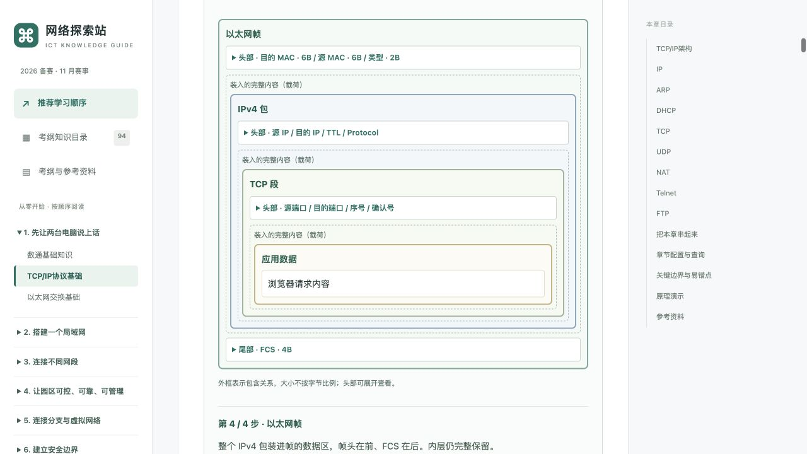
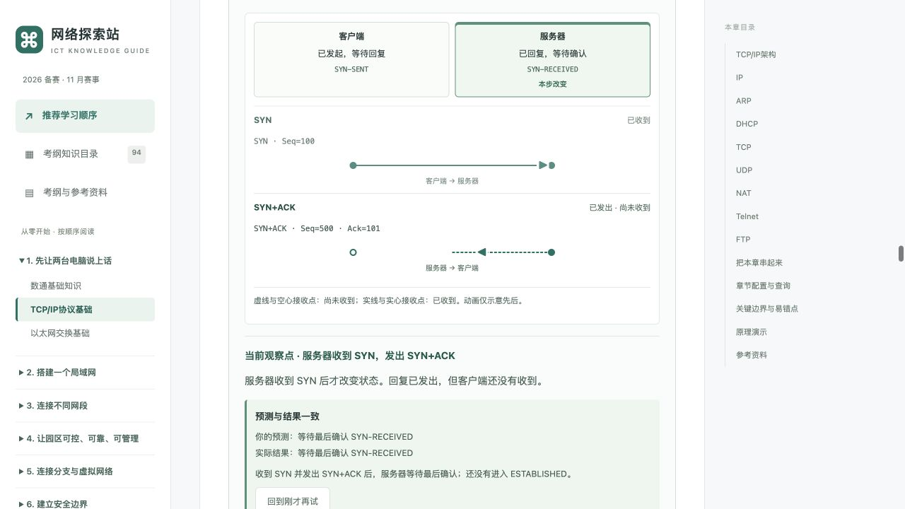
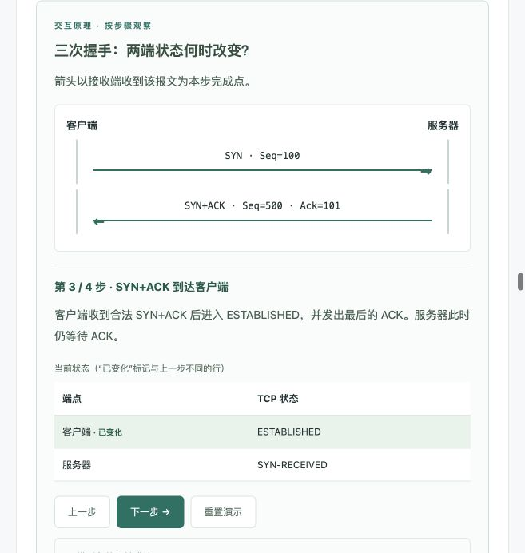

# 教学可视化组件体系（前三课试点）

## ICT-002 第二轮优化（当前行为）

此次仅在 ICT-002 启用新增能力。ICT-001、ICT-003 及其余课程不扩大试点；原词库的 plain/detail 和其他章节场景数据保持不变。

- 报文组件新增 `step.packet` 递归树：`kind/label/header/payload/trailer`。每一层 `payload` 保留上一层的完整树，最终为 Ethernet II → IPv4 → TCP → 应用数据；头部与 FCS 可展开。展示包含关系，不冒充完整位布局。
- 时序组件通过 `richSequence/events` 启用收发阶段；`event.phase` 为 sent、received 或 lost。同一事件在实际操作历史中更新，只有到达才改变接收端。TCP 接收 SYN 后发 SYN+ACK、接收 SYN+ACK 后发 ACK 各合并为一个观察点；未在任意在途步骤提前更新对端。
- 步骤控制器使用实际路径栈，`step.actions` 可指向不同结局。最后 ACK 可交付或丢失；回退、再选择、重置都基于路径，丢失分支不会混入成功分支。丢失后停止观察，不伪造 ACK 自动重传；实际服务器重发 SYN+ACK 等行为在技术边界说明。
- `step.prediction` 提供问题、可选判断及按目标步骤索引的正确结果与原因。选择本身不改变协议状态；操作后对照实际结局反馈，可回到观察点再试，也可不作预测直接操作。无分数、成绩、存储或独立练习页。
- ARP 同/跨网段复用同一时序组件。广播显式送达目标与旁听终端 C，只有匹配目标回答；A 缓存在响应到达时才更新。合并广播收件观察点不代表物理同时到达。
- 术语共享条目新增 `hint/beginner/definition`。ICT-002 正文首次出现只附短提示，弹窗默认显示通俗解释，专业定义用原生 details 按需展开；隐藏考纲不消耗正文“首次出现”。序号、确认号、载荷三个新增词条限定 ICT-002。其他章节保留原解释方式。
- 操作后把视野带回图形，以便直接看报文与端点变化；有限 CSS 动画只表示动作先后，遵循减少动态效果偏好，不替代协议状态模型。没有新增依赖。

验证：3666 项站点回归及 374 项教学断言通过，共 4040 项。浏览器验证正确/错误预测、选择不改变状态、ACK 交付/丢失、ARP 收件与缓存时点、场景清空、术语定义展开；390 像素内嵌视口已操作四层封装。未在真实网络设备执行，也未模拟真实链路时延与重传定时器。

## 首轮设计与内容选择

保持现有阅读页、绿色配色、94章和322项细则。不是每个知识点都配图：空间关系用拓扑，封装用报文结构，消息交换用时序，查表/视图/缓存用状态表；限制条件和配置仍用文字。没有调用生图、增加静态知识点图片或引入任何运行时依赖。此次选择原生 SVG/CSS/JavaScript，Mermaid 可供后续纯流程图采用，当前不额外加载其解析器。

| 组件 | 数据契约 | 行为 |
| --- | --- | --- |
| 拓扑/流向 | nodes: [id,label,x,y]、links、step.active | 共享 SVG 绘制，实线+箭头表示当前事件；窄屏在组件内滑动 |
| 报文结构 | step.fields: [label,detail][] | 每个字段可展开；明确是否完整、是否按比例 |
| 协议时序 | actors、step.message: [from,to,label] | 按步骤累计消息，双向箭头与同步状态表 |
| 状态表 | columns、step.rows | 显示该时刻完整快照，相对上一步标注“已变化” |
| 步骤控制器 | title、summary、steps、boundary、sources | 上一步/下一步/重置；边界禁用；焦点恢复；aria-live；无自动播放 |
| 统一术语 | id、terms 别名、plain、detail | 每章阅读正文首次出现附短解释和点击按钮；弹窗支持 Escape 关闭并恢复焦点 |

数据来源：`content/visualizations.json`、`content/glossary.json`；构建生成 `dist/teaching-data.js`，不要手改生成文件。渲染器为 `dist/teaching.js`，由 `unitSection` 按稳定细则编号放置。相同组件跨课复用，场景切换与路由切换均回到初始状态，不保存学习记录。术语按每章阅读正文重新判断首次出现，不修改标题、导航或命令代码；演示中的字段可点开自身解释。统一术语库入口可查询完整词库，试点覆盖后再推广自动标注。

步骤用完整状态快照，退回/重置不依赖隐式累积副作用。交换学习由纯函数生成快照，当前模型限同一 VLAN，逻辑键相当于 `(VLAN10,MAC)`；未来多 VLAN 场景必须扩展显式复合键，不能直接挪用单 VLAN 索引。未来真实可编辑模拟器也应让纯模型计算状态，避免把高亮动画作为协议真相。

## ICT-001—ICT-003 接入

| 章节 | 接入点 | 可观察结果 |
| --- | --- | --- |
| ICT-001 | .02 通信路径 | 交换机不替换端点 MAC；路由器更换链路封装并递减 TTL |
| ICT-001 | .01 VRP 视图 | 视图切换、运行/启动配置；return 不保存 |
| ICT-002 | .01 封装 | 应用数据 → TCP 段 → IPv4 包 → Ethernet II 帧；字段展开 |
| ICT-002 | .02 TCP | SYN/SYN+ACK/ACK 序号与两端建立状态的不同时间点 |
| ICT-002 | .04 ARP | 同网段/跨网段场景切换；请求、响应、ARP 缓存、数据交付 |
| ICT-002 | 章节原演示 | 保留可输入的 IPv4 前缀计算，不重复制作位图 |
| ICT-003 | .02 学习与转发 | 三帧十步：源学习、未知单播泛洪、已知单播与 MAC 表 |

协议依据随演示技术边界附链接。参考 RFC 9293 §3.5、RFC 826、RFC 894、RFC 1812 及华为命令/保存/MAC学习文档。配置仅针对注明的常见模式，未在赛事设备上验证。

## 验证与后续推广

执行 `python3 build.py`、`node --check dist/teaching.js`、`node test-models.cjs`、`node test-teaching.cjs`。CI 已纳入新检查。模型验证重点为 TCP 两端状态时点、SYN 占序号、ARP 解析本地下一跳、交换源学习/目的查表/同入口过滤、视图退出不保存及场景挂接。原94章、322细则回归仍保留。本轮3666项原站/挂接回归与156项教学断言全部通过。

浏览器已操作：前三课步骤与状态、TCP 两端建立差异、ARP 场景切换后清空缓存、封装字段展开、MAC 表演进、术语弹窗；已在657像素阅读面板和390像素内嵌视口观察阅读布局及组件操作。拓扑在窄屏内部横向滑动，保留文字大小；未模拟真实手机触屏或读屏软件。

后续按以下顺序逐批推广，每批均先核对协议条件与失败路径，再加入场景数据并验证：

1. ICT-004 VLAN：复用拓扑、字段和状态表，接入既有 `vlanSim`，显示标签/PVID/允许列表及丢弃位置。
2. ICT-009 路由：复用查表与流向，接入既有 `selectRoute`，展示最长前缀、优先级、同协议 cost。
3. 其他协议：DHCP、NAT、STP 等按需要选择时序/映射/拓扑，补齐各自状态机和边界，不把正常流程强套给异常过程。
4. 词库按新章节补充与审核后，扩大自动解释范围；不对所有94章盲目插入未经审阅的术语解释。

此次只交付前三课试点；后续课程未宣称已完成可视化改造。

验收截图：

## 2026-10-24 · 全站教程化改造中的组件接入

本轮不再把可视化限制在前三课，而是作为教学正文的一部分插入每个知识点：

- 路径、VRP、封装、TCP、ARP 与交换学习场景仍由 `forUnit(unitId)` 挂接。渲染器把场景放在“含步骤的分节”之后，并先显示本节的 `visualCue`，让读者先知道看什么，再看状态变化。
- 子网、VLAN、路由、交换四个可操作实验改为挂在具体知识点：`ICT-002.05` 子网、`ICT-004.01` VLAN、`ICT-003.02` MAC 学习、`ICT-009.01` 最长前缀。实验在章内按需展开，不单独占页面。
- 术语库从 35 条扩展到 135 条，覆盖数通、安全、WLAN、DCN 与自动化。每条保留 `plain/detail` 兼容字段，并新增 `beginner/definition/hint/annotate`。正文首次出现时只显示短提示；`annotate:false` 的词条只出现在术语库，不插入正文。所有章节都启用“通俗解释 + 折叠专业定义”，不再只限 ICT-002。
- 每章新增学习目标、知识点层次标记、折叠的理解检查、已解案例、技术边界与章末小结；配置与命令说明收进“进阶”折叠区。交互组件的边界仍由每个场景自己的 `boundary` 说明，不在正文重复。
- 新增本机章节完成标记：只保存章节 ID，不记录阅读时长、答题或分数；左侧阶段目录显示完成数，首页显示总进度。无新增运行时依赖，无生图。
- 组件测试仍覆盖快照形状、TCP 两端状态时点、ARP 下一跳与缓存时点、交换学习、术语双层结构；内容层由 `scripts/audit_content.py` 检查 94/322 覆盖、层次、重复句、案例与正文重复、章节目标等。

验证命令：`python3 build.py`、`node test-models.cjs`、`node test-teaching.cjs`、`node scripts/render_check.cjs`、`python3 scripts/audit_content.py`。当前配置仍未在赛事设备上实测。
